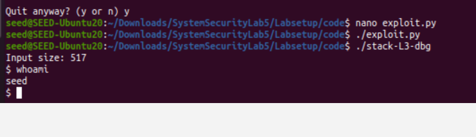

## Overview
Exploiting a 64-bit stack buffer overflow in `stack-L3-dbg` to gain a shell.

## Prerequisites
- Linux (x86_64)
- `gdb` with pwndbg or gef
- Python 3
- Binary compiled without stack canaries / with executable stack as required by the lab

## Step 1 — Find the buffer address
Run gdb on the debug binary and inspect the stack to locate the buffer:


```text
$ gdb ./stack-L3-dbg
(gdb) break main
(gdb) run
(gdb) p &buffer      # note the address
  ```


## Step 2 — Update `exploit.py`
Modify the exploit with the 64-bit shellcode. Key parameters:

- **Shellcode length:** 517 bytes
- **Offset:** 216 bytes
  - Calculated as `(buffer_address - rbp/ret_address)` — the hex difference came out to 208, plus 8 for the 64-bit saved frame pointer alignment.


## Step 3 — Set return address and NOP sled
Update `exploit.py` with:
- The **return address** = buffer address found in Step 1
- **Offset** = 216
- Small padding/NOP sled offset before the shellcode so the return lands cleanly in the sled


## Step 4 — Run the exploit

```
./exploit.py ./stack-L3
```

You should drop into a shell:



> ⚠️ **Known issue:** In my environment the spawned shell is a **seed shell, not root** —
> my machine still doesn't play nicely with zsh. I'm actively working on fixing the
> shell/environment setup. See `notes.md` for progress.

## Notes
See [notes.md](notes.md) for debugging notes and the zsh/shell issue.
EOF
